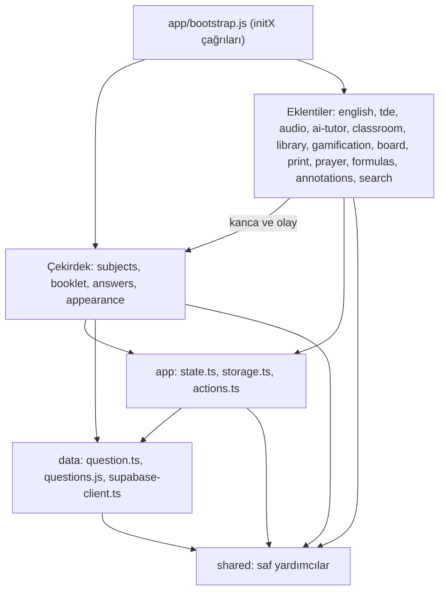

# AÖL Dijital Kitapçık — Master Mimari Blueprint (Nihai Mimari Başvuru)

> **Durum: NİHAİ — 2026-10-30, Faz 8 kapanışı.** Bu dosya projenin tek nihai mimari sözleşmesi ve başvuru belgesidir. `AGENTS.md` çalışma kurallarını, [ARCHITECTURE.md](ARCHITECTURE.md) sözleşmenin uygulama haritasını tanımlar.
> **Arşiv:** [EVREN_MIMARI_PLAN.md](archive/EVREN_MIMARI_PLAN.md) ve [STATE_MIMARI_PLAN.md](archive/STATE_MIMARI_PLAN.md) yalnızca tarihsel kayıttır; uygulanacak plan değildir.
> **Kapsam:** Faz 0–6 uygulanmıştır; Faz 8 belgeleri kapatır. İsteğe bağlı Faz 7 uygulanmamıştır ve bu kapanış onu yetkilendirmez.
> **Okuma kuralı:** Aşağıdaki güncel sözleşme esas alınır. İlk bulgular ve faz adımları dönüşüm geçmişidir; eski dosya yolları, ölçümler ve kod örnekleri güncel uygulama talimatı sayılmaz. Yeni bir değişiklikte bulgu önce kodda doğrulanır.

## Güncel sözleşme ve kapanış

| Sorumluluk | Nihai uygulama noktası ve güvence |
|---|---|
| Çekirdek / eklenti sınırı | `answers`, `booklet`, `subjects`, `appearance` eklentileri doğrudan import etmez. Başlatma bağlantıları `src/app/bootstrap.js` içindedir. |
| Durum ve olaylar | Durum mutasyonları `src/app/state.ts` içindeki `store` üzerinden yapılır; tipler `state-types.ts`, olaylar `state-events.ts` içindedir. Eski tip importları yeniden dışa aktarılır. |
| Cevap ve kart uzantıları | Eklentiler cevap olayları ve `src/features/booklet/card-hooks.ts` kancalarıyla bağlanır. `tests/jenga-core.test.ts` eklentiler başlatılmadan kart üretimini ve cevap kaydını doğrular. |
| Arayüz eylemleri | `src/app/actions.ts` kayıtları özelliklerin `init` modüllerinde yapılır; `events.js` delegasyon ve mevcut inline olay uyumluluğu sınırıdır. |
| Kalıcılık | Doğrudan tarayıcı depolaması yalnızca `src/app/storage.ts` içindedir. Anahtar değerleri `src/shared/storage-keys.ts` ve katı sözleşme testleriyle korunur. Kullanıcı verisi taşınmaz. |
| Veri katmanı | `src/data/questions.js` soruları döndürür; state'e ekleme çağıran tarafa aittir. Önbellek ve eşzamanlı promise paylaşımı korunur; `data → app` bağımlılığı yasaktır. |
| Satır payı | Kaynak JS/TS/CSS dosyalarında üst sınır 300 satırdır. Mimari denetim aşımı hata sayar; sorumluluk bazlı bölme kullanılır. |
| TTS yardımcıları | API route'u `functions/api/tts.ts`, sağlayıcı yardımcıları route dizini dışındaki `edge/tts-providers.ts` içindedir. |

`scripts/check-architecture.js` çekirdek/eklenti ve uygulama/eklenti sınırlarını, katmanları, döngüleri, depolama kapısını ve satır sınırını denetler. `npm run check` lint, strict TypeScript, mimari kontrol ve 29 test dosyasını; `npm run build` bunların ardından üretim çıktısını doğrular. Son Faz 6 tarayıcı doğrulaması 12/12 geçmiştir; yalnızca belge değiştiren Faz 8'de E2E yeniden çalıştırılmaz.

Nihai kabul: `npm run check` ve `npm run build` başarılı, mimari hata sayısı 0, 29/29 test dosyası yeşil. Mevcut tek mimari uyarı `bootstrap.js` dosyasındaki 28 doğrudan bağımlılıktır; bu, eklentilerin bağlandığı bileşim noktasıdır. Tüm eklenti kombinasyonlarının fiziksel olarak silinmesi bu kabulün test kapsamı değildir; otomatik Jenga güvencesi çekirdeğin eklenti başlangıçları olmadan çalışması ve import sınırlarıyla ölçülür.

---

## 0. Hedef: Jenga Mimarisi

Bir özelliği çıkarınca sistemin geri kalanı **derlenmeye ve çalışmaya devam etmelidir.** Bunun ölçülebilir tanımı:

1. **Çekirdek (core)** özellikler: `subjects`, `booklet`, `answers`, `appearance`. Kitapçık bunlarsız çalışmaz.
2. **Eklenti (plugin)** özellikler: `ai-tutor`, `annotations`, `audio`, `board`, `classroom`, `english`, `formulas`, `gamification`, `library`, `prayer`, `print`, `search`, `tde`.
3. **Altın kural:** Hiçbir modül bir eklentiyi import edemez; bunun tek istisnası eklentinin kendi dosyaları ve `src/app/bootstrap.js` içindeki tek `initX()` çağrısıdır. Eklentiler çekirdeğe **olay (event)** veya **kanca (hook)** ile bağlanır.
4. **Jenga testi:** `bootstrap.js` içinde bir eklentinin `initX()` satırı silinince `npm run check` ve `npm run test:e2e` geçmeye devam etmeli (o eklentinin kendi testleri hariç).

Bu hedef yeni bir çatı (framework) gerektirmez. Olay veriyolu `onStateChange` / `notifyStateChange`, `src/app/state-events.ts` içinde tanımlanır ve `state.ts` üzerinden de dışa aktarılır. **Yeni runtime kütüphanesi yok, React yok, IndexedDB yok.**

---

## 1. Başlangıç denetimi (tarihsel — HEAD `8fe8cc77`)

Bu tablodaki ölçümler refactor öncesine aittir; güncel kabul yukarıdaki kapanış bölümündedir.

| Ölçüm | Değer | Doğrulama |
|---|---|---|
| `npm run check` | 0 hata, 4 uyarı, 89 test geçer | `npm run check` |
| `npm run test:e2e` | 11/11 geçer | `npm run test:e2e` |
| Doğrudan `state.x = ...` mutasyonu | **0** (tümü `store.*` üzerinden) | `git grep -E "state\.[a-zA-Z]+\s*=" src/` |
| Kalan `.js` kaynak dosyası | 19 | `find src -name "*.js" \| grep -v generated` |
| 330+ satırlık dosya | 12 (en büyüğü 348) | `wc -l` |
| `state.ts` dışında `localStorage` çağrısı | **9 dosya** | `grep -rn "localStorage\." src` |
| Özellikten özelliğe import | 18 kenar (aşağıda) | bağımlılık taraması |
| Testi olmayan özellik | `appearance`, `prayer`, `print`, `search`, `subjects` | `grep -l features/X tests/` |

**Önceki planlardaki düzeltilen yanlışlar** (bunları uygulama):
- Classroom **PeerJS/WebRTC kullanmaz**: `BroadcastChannel` ile Supabase Realtime `WebSocket` kullanır (`room-channel.ts:18-19`).
- Projede `main.tsx`/React yok; giriş noktası `src/main.js`.
- Denetleyicinin adı `scripts/check-architecture.js` (`.mjs` değil).
- `Object.freeze(window)` **önerisi tehlikelidir**: üçüncü taraf ve tarayıcı atamalarını bozar. Uygulanmaz.
- IndexedDB/outbox/migration katmanı **kapsam dışıdır**: veri `localStorage` üzerinde kalır.
- State'i 5 dosyaya bölmek aşırıdır. En fazla tipler ayrı dosyaya taşınır (Faz 6).
- `notify` içinde "re-entrant ise sessizce çık" bayrağı **eklenmez**: iç içe meşru bildirimleri sessizce yutar.

---

## 2. İlk bulgular (tarihsel, önem sırasına göre)

### K1 — KRİTİK: Ölü veya yanlış depolama anahtarları (veri kaybı tuzağı)
`src/shared/storage-keys.ts` içinde iki anahtar **gerçekte kullanılan anahtarla eşleşmiyor**:

| Sözlükteki değer | Gerçekte yazılan anahtar | Yazan dosyalar |
|---|---|---|
| `REMATCH_QUESTIONS: 'aol_rematch_questions'` | `'aol_rematch_queue'` | `app/state.ts:9`, `library/library-model.ts:4` |
| `RESUME_STATE: 'aol_resume_state'` | `'aol_last_session'` | `booklet/resume.ts:9` |

Sözlükte hiç olmayan literal anahtarlar: `aol_last_streak_date` (`state.ts:10`), `aol_classroom_session` (`classroom/session-store.ts:9`). `streak.ts:3` ve `library-model.ts:3` ise sözlükteki değeri literal olarak tekrar yazıyor.
**Risk:** Biri "temizlik" amacıyla `StorageKeys.REMATCH_QUESTIONS` sabitine geçerse tüm öğrencilerin rövanş havuzu görünmez olur.

### K2 — YÜKSEK: Çekirdek modül eklentiye bağımlı (Jenga ihlali)
`src/features/answers/marking.ts` doğrudan şunları import ediyor:
- `classroom/room-service.ts` (`roomService.logStudentAnswer`, `revokeStudentAnswer`; satır 7, 27, 87)
- `gamification/combo-toast.ts`, `gamification/streak.ts` (satır 4-5)
- `library/library-model.ts` (satır 6)

Classroom, gamification veya library silinirse **cevap işaretleme derlenmez**.

### K3 — YÜKSEK: Kitapçık eklentilere bağımlı
- `booklet/question-card.ts` → `english/levels.js`, `english/vocabulary.js`, `english/interlinear.ts` (satır 3-6)
- `booklet/features-bar.ts` → `audio/speech-service.ts` (satır 3)
- `print/print.js` → `english/interlinear.ts` (eklentiden eklentiye)

### K4 — ORTA: Özellik düzeyinde döngü (`booklet` ↔ `subjects`)
- `subjects/topics.js:4`, `subjects/exam-periods.ts:4`, `library/library-drawer.ts:5` → `booklet/filter.updateFilterButtonsUI`
- `booklet/selection.js:5` → `subjects/topic-model.js`

`booklet/filter.ts:108` zaten `onStateChange('filter:updated')` dinliyor. Bu yüzden ilk üç import gereksiz.

### K5 — ORTA: Kalıcılık 9 dosyaya dağılmış
`localStorage` doğrudan şu dosyalarda çağrılıyor: `appearance/preferences.ts`, `answers/storage.ts`, `library/library-model.ts`, `classroom/room-channel.ts`, `booklet/resume.ts`, `audio/voice-gender.ts`, `gamification/streak.ts`, `ai-tutor/ai-tutor.ts`, `app/bootstrap.js`. Her biri kendi `try/catch` ve JSON parse mantığını yazıyor.

### K6 — ORTA: `events.js` merkezi bağımlılık düğümü
277 satır, 22 modül importu, 51 `case` içeren tek `switch` ve `window` üzerine 26 fonksiyon. Her yeni buton bu dosyayı büyütüyor.

### K7 — ORTA: Veri katmanı uygulama katmanına bağımlı
`src/data/questions.js:1` → `app/state.ts` (`store.appendQuestions`, satır 17). Veri katmanı yalnızca veri döndürmeli.

### K8 — ORTA: Güvenlik ağı deliği
- `AGENTS.md` "en fazla 350 satır" diyor, ama `check-architecture.js` bunu yalnızca **uyarı** olarak veriyor.
- `functions/` klasörü **tsconfig, ESLint ve mimari denetimin dışında** (`tsconfig.json: include ["src/**/*.ts"]`). `functions/api/tts.ts` 343 satır.

### K9 — DÜŞÜK: Satır sınırına dayanan dosyalar
`classroom/message-handler.ts` (348), `ai-tutor/ai-tutor.ts` (346), `audio/speech-provider.ts` (346), `styles/ai-tutor.css` (346), `classroom/room-ui.ts` (344), `app/state.ts` (343), `functions/api/tts.ts` (343), `styles/translations.css` (342), `styles/drawer.css` (342). Bu dosyalara özellik eklemeden önce bölünmeleri gerekir.

### K10 — DÜŞÜK: `docs/ARCHITECTURE.md` bayat
Var olmayan dosyalara referans veriyor: `answers/marking.js`, `answers/reveal.js`, `answers/storage.js`, `calculator/calculator.js`, `scripts/core/evren_iterative_audit_pipeline.py`, `CNAME`. Ayrıca "özellikler açık import ile birbirini çağırır" cümlesi Jenga hedefiyle çelişiyor.

---

## 3. Dönüşüm fazlarının kaydı

Her faz **tek PR/commit**'tir. Her fazdan sonra `npm run build` çalıştırılır. Arayüz, olay veya veri yükleme değiştiyse `npm run test:e2e` de çalıştırılır. Kırmızı test varken sonraki faza geçilmez.

### Faz 0 — Güvenlik ağı (önce kural, sonra refactor)
1. `scripts/check-architecture.js`:
   - `lines > 350` → **ERROR** (bugün tüm dosyalar ≤ 348; kırılma olmaz).
   - Taramaya `functions/` eklenir (satır sınırı ve eksik import).
2. `functions/` için ayrı tip denetimi: `tsconfig.functions.json` oluşturulur ve `typecheck` betiğine eklenir. Çıkan hatalar düzeltilir; `any` ve `@ts-ignore` kullanılmaz.
3. **Kabul:** `npm run check` yeşil.

### Faz 1 — Depolama anahtarlarının tek gerçeği (K1)
1. `StorageKeys` değerleri **gerçekte kullanılan** anahtarlara düzeltilir. Kullanıcı verisi değişmez:
   `REMATCH_QUESTIONS: 'aol_rematch_queue'`, `RESUME_STATE: 'aol_last_session'`. Eklenecekler: `LAST_STREAK_DATE: 'aol_last_streak_date'`, `CLASSROOM_SESSION: 'aol_classroom_session'`.
2. Tüm `'aol_...'` literalleri `StorageKeys.*` ile değiştirilir.
3. Test `tests/storage-keys.test.ts`: her anahtarın **tam string değeri** sabitlenir. Bir anahtar değişirse test kırılır.
4. Denetleyiciye kural: `'aol_` literali yalnızca `src/shared/storage-keys.ts` içinde geçebilir → ERROR.
5. **Kabul:** Eski tarayıcı verisiyle açılışta rövanş, kaldığı yer ve seri korunur. Bunun için `tests/browser/regressions.spec.js` dosyasına `localStorage` önceden doldurulmuş bir senaryo eklenir.

### Faz 2 — Kalıcılık tek kapıdan (K5)
1. `src/app/storage.ts` oluşturulur (~30 satır, strict TS):
   ```ts
   import type { StorageKey } from '../shared/storage-keys.ts';
   export function readJson<T>(key: StorageKey, isValid: (v: unknown) => v is T, fallback: T): T { /* try/parse/validate */ }
   export function writeJson(key: StorageKey, value: unknown): boolean { /* try/catch, QuotaExceeded → false */ }
   export function readString(key: StorageKey): string | null { /* try/catch */ }
   export function writeString(key: StorageKey, value: string): boolean { /* try/catch */ }
   export function remove(key: StorageKey): void { /* try/catch */ }
   ```
2. K5'teki 9 dosya ve `state.ts` içindeki `safeStorageSet` bu modüle geçirilir. Mevcut doğrulama fonksiyonları (`saved-choices.ts` vb.) `isValid` parametresi olarak verilir.
3. Denetleyici: `localStorage` yalnızca `src/app/storage.ts` içinde geçebilir → ERROR.
4. **Kabul:** Mevcut "bozuk localStorage temizlenir" testleri geçer. `readJson` için bozuk JSON, yanlış tip ve eksik anahtar testleri eklenir.

### Faz 3 — Çekirdeği eklentilerden ayır (K2, K3, K4)
**3a. Cevap olayları** (`answers` → olay):
- `StateEventType` tipine `'answer:marked'` ve `'answer:revoked'` eklenir.
- Payload tipi: `interface AnswerMarkedEvent { readonly qid: number; readonly choice: Choice; readonly isCorrect: boolean }` ve `interface AnswerRevokedEvent { readonly qid: number }`. `StateListener` payload'u `unknown` olduğu için dinleyici tarafında küçük bir tip koruyucu (type guard) kullanılır.
- `marking.ts` içindeki `roomService`, combo, streak ve rematch çağrıları **aynı sırayla** `notifyStateChange(...)` ile değiştirilir.
- Dinleyiciler eklentinin kendi `init` fonksiyonunda kaydedilir: `initGamification()` (combo + streak), `initLibrary()` (rematch ekle/çıkar), `initRoomFeature()` (log/revoke). Kayıt sırası bugünkü çağrı sırasıyla aynı olmalı; veriyolu eşzamanlı çalışır.
- `tests/confidence-streak.test.ts` içindeki `handleSelectOpticalBubble` testleri, ilgili `init` fonksiyonlarını çağırarak aynı davranışı doğrulamaya devam eder.

**3b. Kart kancaları** (`booklet` → `english`, `audio`):
- `src/features/booklet/card-hooks.ts` oluşturulur (~30 satır):
  ```ts
  export interface CardHook {
    stem?(q: Question, html: string): string;   // soru kökünü zenginleştir
    header?(q: Question): string;               // başlık rozetleri (CEFR vb.)
    toolbar?(q: Question): string;              // özellik çubuğu butonları
  }
  export function registerCardHook(hook: CardHook): void;
  export function applyStem(q: Question, html: string): string;
  export function renderHeaderExtras(q: Question): string;
  export function renderToolbarExtras(q: Question): string;
  ```
- `question-card.ts` ve `features-bar.ts` içindeki `english/*` ve `audio/*` importları kaldırılır; yerlerine kanca çağrıları gelir.
- `english` yeni bir `initEnglish()` içinde kancasını kaydeder. `audio` ise "seslendir" butonunu `toolbar` kancasıyla ekler.
- Eklentiden çıkan HTML, mevcut `escapeHtml` kurallarına tabidir.

**3c. Yazdırma** (`print` → `english`):
- `isEnglishQuestion` saf bir fonksiyondur → `src/shared/` altına taşınır.
- `applyInterlinearToBooklet` için `print`, yazdırmadan önce `notifyStateChange('print:before')` bildirir; `english` bunu dinler.

**3d. Döngüyü kır** (K4):
- `subjects/topics.js`, `subjects/exam-periods.ts`, `library/library-drawer.ts` içindeki `updateFilterButtonsUI()` çağrıları `notifyStateChange('filter:updated')` ile değiştirilir; dinleyici zaten mevcut.

**3e. Kural:** Denetleyiciye `PLUGINS` listesi eklenir. `features/A` → `features/P` (P eklenti, A ≠ P) importu → ERROR. `app/bootstrap.js` dışında `app/*` → eklenti importu → ERROR (bu kural Faz 4'ten sonra açılır).

**Kabul:** Bölüm 0'daki Jenga testi `classroom`, `gamification`, `library`, `english` ve `audio` için elle yapılır ve sonuç commit mesajına yazılır.

### Faz 4 — `events.js` boşaltma (K6)
1. `src/app/actions.ts` oluşturulur (~25 satır):
   ```ts
   export type ActionHandler = (el: HTMLElement, ev: Event) => void;
   export function registerActions(map: Readonly<Record<string, ActionHandler>>): void; // aynı ad iki kez → console.error
   export function runAction(name: string, el: HTMLElement, ev: Event): boolean;
   ```
2. `events.js` içindeki `switch` bloğu kaldırılır. Delegasyon döngüsü `closest('[data-action]')` sonrasında `runAction` çağırır. Her özellik kendi aksiyonlarını kendi `init` fonksiyonunda kaydeder.
3. `registerLegacyHandlers()` yalnızca **hâlâ inline şablonlarda kullanılan** isimleri tutar (bugün şablonlarda 17 inline handler var). Her inline handler `data-action`'a çevrildikçe listeden silinir.
4. `change` dinleyicisindeki sabit `#chkIntersectionSwitch` ID'si `data-action` ile değiştirilir.
5. **Kabul:** `events.js` hiçbir eklentiyi import etmez. E2E testleri geçer. Mimari uyarı sayısı düşer.

### Faz 5 — Veri katmanını saflaştır (K7)
- `data/questions.js` soruları **döndürür**, `store.appendQuestions` çağrısı çağıran tarafa (`bootstrap`/`subjects`) taşınır. Aynı promise'in tekrar kullanılması davranışı korunur.
- Denetleyici: `data/*` → `app/*` importu → ERROR.
- Mevcut "yavaş ders isteği son seçilen dersi değiştirmez" ve "yükleme hatasında önceki kitapçık korunur" E2E testleri geçmelidir.

### Faz 6 — Satır sınırı payı (K9)
Sorumluluk bazlı bölme yapılır; satır sıkıştırma yasaktır:
- `app/state.ts` → `AppState`, `MutableAppState` ve ilgili tipler `app/state-types.ts` dosyasına taşınır. `state.ts` yeniden dışa aktarır (`export type`) ve dış importlar değişmez.
- `classroom/message-handler.ts` → mesaj türü başına işleyici tablosu: `message-handlers/host.ts` ve `student.ts`.
- `ai-tutor/ai-tutor.ts` → `ai-tutor-api.ts` (istek/yanıt) ve `ai-tutor-view.ts` (DOM).
- `audio/speech-provider.ts` → sağlayıcı başına bir dosya.
- `functions/api/tts.ts` → sağlayıcı yardımcıları route oluşturmayan bir klasöre taşınır (deploy Cloudflare Pages: `wrangler.toml: pages_build_output_dir`). `functions/` altındaki her dosya route olabilir; yardımcıların route'a dönüşmediği build çıktısıyla doğrulanır.
- CSS: `ai-tutor.css`, `translations.css`, `drawer.css` bileşen bazında bölünür.
- **Hedef:** Hiçbir dosya 300 satırı geçmez (50 satır pay).

### Faz 7 — EVREN entegrasyonu (Jenga tamamlandıktan sonra, isteğe bağlı)
Mevcut durum: `functions/api/ask-ai.ts` önce EVREN'i dener, sonra Gemini'ye düşer (satır 145+). `functions/api/tts.ts` ElevenLabs, OpenAI ve Gemini kullanır; **EVREN TTS yok**.
1. Model adları ve EVREN temel URL'si tek bir edge yardımcı modülünde sabitlenir. Route dosyalarında model string'i yazılmaz.
2. `voxcpm2` sağlayıcısı eklenir: `POST /v1/audio/speech`, sesler `deniz | ece | emre | kaan` (`evrendocs/models_catalog.md:120`). Kodlamadan önce **gerçek bir istekle** yanıt biçimi (format, MIME) doğrulanır.
3. Sağlayıcı sırası ortam değişkenleriyle yönetilir. Biri hata verirse sonrakine düşülür (mevcut desen korunur).
4. İstemci tarafında `speech-provider` sözleşmesi değişmez; yeni motor yalnızca sunucu tarafında eklenir.
5. Kapsam dışı (ayrı karar gerektirir): `qwen3-guard-4b` moderasyon, `clef`/`laya` zorluk puanlama, embedding/rerank. Bunlar veri hattı (Python) işleridir; arayüz kodunu değiştirmez.

### Faz 8 — Belgeler (K10)
- `docs/ARCHITECTURE.md`: bayat 6 referans düzeltilir. "Özellikler açık import ile birbirini çağırır" cümlesi çekirdek/eklenti kuralıyla değiştirilir. `card-hooks`, `actions`, `storage` modülleri haritaya eklenir.
- `docs/EVREN_MIMARI_PLAN.md` ve `docs/STATE_MIMARI_PLAN.md` silinir veya `archive/` altına taşınır.

---

## 4. Yapılmayacaklar (anti-bloat)
- React, Redux, Zustand ya da herhangi bir yeni runtime kütüphanesi.
- IndexedDB, outbox veya senkron kuyruğu.
- `Object.freeze(window)`, runtime `freezeDeep`, her `set` çağrısında kopyalama.
- State'i 2 dosyadan fazlasına bölmek.
- Henüz kullanılmayan kancalar, olay tipleri veya "ileride lazım olur" soyutlamaları. Her kanca ve olay tipinin en az bir gerçek kullanıcısı olmalı.
- Testleri silmek veya `skip` etmek; `any`, `@ts-ignore`, eslint-disable.
- `aol_*` anahtar **değerlerini** değiştirmek. Faz 1, sözlüğü gerçek değerlere uydurur; veriyi taşımaz.

---

## 5. Hedef Bağımlılık Şeması



Yasak oklar: `core → plugins`, `plugin → başka plugin`, `data → app`, `shared → app/features/data dışı`, `app/* (bootstrap hariç) → plugins`.

---

## 6. İlk başlangıç talimatı (tarihsel — yeniden uygulanmaz)

> `AGENTS.md` ve `docs/MASTER_MIMARI_BLUEPRINT.md` belgelerini oku. Yalnızca **Faz 0**'ı uygula. Her değişiklikten önce bulgudaki doğrulama komutunu çalıştırıp durumun hâlâ geçerli olduğunu teyit et. `npm run build` çalıştır; arayüz değiştiyse `npm run test:e2e` de çalıştır. Değişen dosyaları, eklenen kuralları ve test sonuçlarını raporla. Faz 0 onaylanmadan Faz 1'e geçme.

