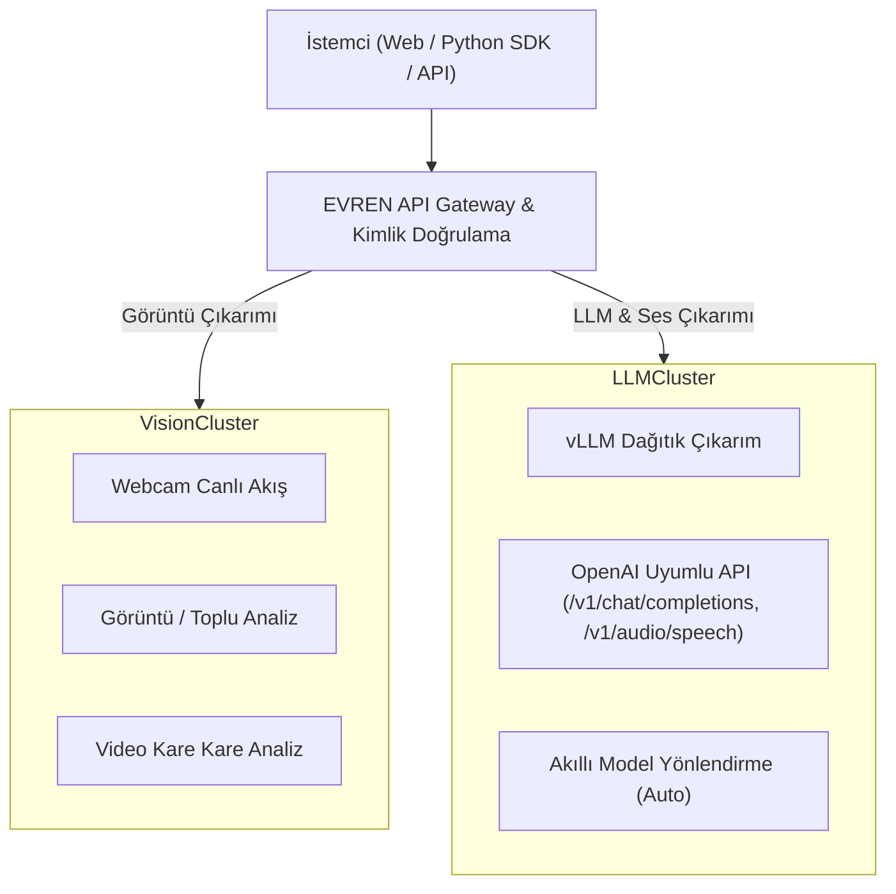

# EVREN Platform ve Çıkarım Servisi Dokümantasyonu

> **Konsey Notu:** Bu doküman, T.C. Cumhurbaşkanlığı Savunma Sanayii Başkanlığı (SSB) bünyesindeki Savunma Sanayii Yapay Zeka (SSYZ) inisiyatifi tarafından geliştirilen **EVREN** platformunun resmi teknik mimarisini, yeteneklerini, model kataloğunu ve operasyonel standartlarını içerir.

---

## 1. Platform Özeti ve Anlamı

* **Platform Adı:** EVREN
* **Açılımı:** **E**tiketli **V**eri, **R**eferans **E**ğitim **N**etworku
* **Konsept:** Savunma Sanayiinin Yapay Zeka EVREN'i — Veri etiketlemeden model eğitimine, deney takibinden dağıtık görüntü ve LLM çıkarımına kadar tüm yapay zeka yaşam döngüsünü milli ve egemen bare-metal altyapıda birleştiren uçtan uca ekosistem.
* **Aktif Oturum & Hesap Bağlamı:**
  * **Kullanıcı:** Muhammed Emin Çelenk (`emntarcin@tutamail.com`)
  * **Mevcut Kredi Bakiyesi:** `1.030,0 CR`
  * **Ücretsiz Erişim Politikası:** EVREN Çıkarım Servisi'ne ücretsiz erişim dönemi **1 Aralık 2026** tarihine kadar uzatılmıştır.

---

## 2. Canlı Platform Göstergeleri (Metrikler)

| Gösterge | Değer | Açıklama |
| :--- | :--- | :--- |
| **Kayıtlı Kullanıcı** | 28,1K+ | Savunma sanayii, kamu, akademi ve ekosistem kullanıcıları |
| **Veri Seti** | 3,6K+ | Versiyonlanmış ve bölümlenmiş veri setleri |
| **Eğitilen/Paylaşılan Model** | 1,8K+ | Görüntü, ses ve dil modelleri |
| **Veri Öğesi** | 51,0M+ | Ham ve işlenmiş veri birimleri |
| **Etiket Sayısı** | 190,2M+ | Anotasyonu tamamlanmış nesne/metin/ses etiketi |
| **Tüketilen GPU Saati** | 53,1K+ | Dağıtık HPC kümesinde tamamlanan eğitim süresi |
| **Depolanan Veri Hacmi** | 24.2 TB | Güvenli yerel depolama alanı |
| **Üretilen LLM Token** | 1,3 Trilyon (1,3T) | Çıkarım servisi üzerinden üretilen toplam token hacmi |

---

## 3. Portal Navigasyon ve Modül Mimarisi

Platform içi iş akışları 6 ana fonksiyonel grup altında yapılandırılmıştır:

| Modül Grubu | Alt Modüller ve Servisler |
| :--- | :--- |
| **Ana Menü** | Gösterge Paneli, Veri Setleri, Modeller, Projeler, EVREN Kaşifi |
| **Atölye** | Eğitim, Çıkarım (Vision), GPU Rezervasyon |
| **LLM Çıkarım** | LLM Sohbet, Kullanımım, Modeller ve API, Test Alanı, API Anahtarları, Sistem Durumu |
| **Keşfet** | Keşif Merkezi, Liderlik Tablosu |
| **Araçlar** | Katkılarım, Sorun Panosu, Koleksiyonlar, Webhook'lar |
| **Yönetim** | Mesajlar, Bildirimler, Oylama Merkezi, Organizasyon, Kredi Merkezi, API Anahtarları, Ayarlar, Kullanım Kılavuzu, Sürüm Notları |

---

## 4. Temel Platform Yetenekleri

### 4.1. Veri Yönetimi
* Veri setlerinin anlık sürüm kontrolü (versiyonlama).
* Otomatik kalite skoru ve doğrulama mekanizmaları.
* Eğitim, doğrulama ve test (Train / Val / Test) için otomatik veri bölümleme.

### 4.2. Akıllı Etiketleme ve Ön-Anotasyon
* **Desteklenen Etiketleme Türleri:**
  * Sınırlayıcı Kutu (Bounding Box - BBox)
  * Yönlü Kutu (Oriented Bounding Box - OBB)
  * Poligon (Segmentasyon)
  * Anahtar Nokta (Keypoint Pose Estimation)
  * Metin Varlık İsimlendirme (NER)
  * Ses Bölgesi (Audio Segment) Etiketleme
* **Otomatik Ön Etiketleme:** SAM 3 (Segment Anything Model 3) ve YOLO entegrasyonu ile büyük veri kümelerinde yarı-otonom etiketleme desteği.

### 4.3. HPC Dağıtık Model Eğitimi ve Küme Telemetrisi
* **İş Yükü Orkestrasyonu:** Slurm iş yöneticisi ve Apptainer konteynerizasyon mimarisi üzerinde bare-metal HPC kümesi.
* **Donanım Topolojisi:** 8 Düğüm (`Düğüm 1` – `Düğüm 8`) × 8 GPU = Toplam **64× NVIDIA H200 GPU** (141 GB HBM3e / GPU, Toplam **8.947 GB VRAM**).
* **Ara Bağlantı:** InfiniBand NDR 400 Gbps ultra düşük gecikmeli küme ağı.
* **Hesaplama Kapasitesi:** 47.5k TFLOPS (FP16 Tensor Core).
* **Desteklenen Vizyon Eğitim Mimarileri:** YOLO serisi (YOLO11, YOLO26), D-FINE (`dfine-l`, `dfine-m` vb.), SAM 3 ve özel modeller.

### 4.4. Deney Takibi (Experiment Tracking)
* Tüm model eğitim koşularının (runs) hiperparametre, epoch ilerlemesi, kalan süre tahmini, metrik ve log kayıtlarının merkezi ortamda canlı izlenmesi.

### 4.5. Kurumsal Güvenlik ve Uyumluluk
* Kurumsal SSO (Single Sign-On) entegrasyonu (Keycloak & ssb.gov.tr Kimlik).
* Rol Tabanlı Erişim Denetimi (RBAC) ve organizasyonel izolasyon.
* Uçtan uca denetim günlükleri (audit logs) ve KVKK tam uyumluluğu.

---

## 5. EVREN Çıkarım Servisi Mimarisi

Çıkarım altyapısı, iş yükünün doğasına göre iki ayrık kümede optimize edilmiştir:



### 5.1. Görüntü Çıkarım Servisi (Vision Inference)
* **Sunucu Düğümü:** `inference-13` — 8× NVIDIA RTX A6000 GPU (48 GB GDDR6X, toplam 384 GB VRAM).
* **Performans:** <50 ms gecikme süresi ile gerçek zamanlı tespit.
* **Eşzamanlılık:** 40+ eşzamanlı aktif kullanıcı/oturum desteği.
* **Model Yelpazesi:** YOLO26, YOLO11, D-FINE, SAM 3 ve kullanıcıların platformda eğittiği özel vizyon modelleri.
* **Girdi Kanalları:**
  * **Webcam:** Tarayıcı üzerinden doğrudan kamera akışı ile canlı çıkarım.
  * **Görüntü:** Tekil veya toplu görsel yükleme ile yüksek hızlı çıkarım.
  * **Video:** Video dosyaları üzerinde kare bazlı gerçek zamanlı tespit ve segmentasyon.

### 5.2. LLM ve Ses Çıkarım Servisi (Large Language & Audio Models)
* **Özel Donanım Havuzu:** Bare-metal NVIDIA H200 GPU kümesi.
* **Anlık Çıkarım Gücü:** ~13.566 Token / Saniye anlık üretim kapasitesi.
* **Model Filosu:** 16/16 çevrimiçi canlı model havuzu.
* **Arayüz:** OpenAI uyumlu uç noktalar (`/v1/chat/completions`, `/v1/audio/speech`), SSE akış yanıtları, KV-cache afinite yönlendirmesi.
* **Veri Güvencesi:** Çıkarım istekleri hiçbir üçüncü ülke bulut servisine çıkmaz; veriler yurt içindeki milli sunucularda işlenir.

---

## 6. Güncel Model Notları, Sürüm Geçişleri ve Özel Modeller

### 6.1. DeepSeek-V4.1-Flash (`1017` Sürümü) ve Kapasite Artışı
* **Model Adı:** `deepseek-v4.1-flash` (Katalog etiketi: `1017` — 17 Ekim 2026 sürümü).
* **Kapasite Artışı:** `deepseek-v4-flash` modelinin 20 Ekim 2026'da emekliye ayrılmasıyla sunucu kapasitesi `deepseek-v4.1-flash` modeline aktarılmış ve kapasite 3 sunucu grubundan 4 sunucu grubuna (%33 artış) çıkarılmıştır.
* **Eski Model Yönlendirme Kuralı (Deprecation Policy):**
  * **1 Ocak 2027** tarihine kadar `deepseek-v4-flash` model adıyla gönderilen API istekleri kesintisiz olarak otomatik `deepseek-v4.1-flash` modeline yönlendirilir.
  * **1 Ocak 2027** itibarıyla `deepseek-v4-flash` model adı kullanımdan tamamen kaldırılacaktır.
* **Teknik Yetenekler:** 1 milyon (1M) token bağlam penceresi, araç çağrısı (tool calling), görsel anlama ve 1-100 arası ayarlanabilir düşünme bütçesi.
* **Performans Karşılaştırması (Önceki Sürüm → 1017 Sürümü):**
  * **Terminal-Bench 4.0:** `31,2` → `42,3`
  * **DeepSWE v1.1:** `74,2` → `77,0`
  * **ProgramBench:** `20,3` → `29,1`
  * **Automation-Bench v1.0.6:** `54,8` → `60,5`
  * **Apex Bench v1.1:** `64,6` → `72,1`
  * **HLE (Araçsız):** `36,8` → `42,6`
  * **AI Coding Daily:** `61,2 / 80` (en yüksek düşünme ayarında)
* **Önerilen Kullanım Parametreleri:**
  * Örnekleme: `temperature: 1.0`, `top_p: 1.0`.
  * Uzun soluklu ajan görevlerinde `max_tokens` değerinin yüksek tutulması ve talimat/görev kapsamının net tanımlanması önerilir.

### 6.2. VoxCPM2 Metinden Sese (TTS) Modeli
* **Model Adı:** `voxcpm2` (OpenAI uyumluluğu kapsamında `tts-1` takma adıyla da doğrudan çağrılabilir).
* **Geliştirici & Lisans:** OpenBMB / Apache-2.0 (EVREN yerel sunucularında barındırılır).
* **Teknik Özellikler:**
  * **Ses Kalitesi:** 48 kHz yüksek çözünürlüklü ses çıktısı.
  * **Türkçe Başarımı:** Türkçe sayı, tarih, saat ve kısaltmaları doğru okur; çok dilli testte Türkçe Kelime Hata Oranı (WER) **%0,82**'dir.
  * **Üretim Hızı:** Gerçek zamanın ~8 katı hızda üretim; akışlı (streaming) kullanımda ilk ses 1–2 saniye içinde başlar.
  * **Ton ve Üslup Kontrolü:** Sesin tonu ve üslubu düz metin talimatlarıyla (`instructions`) yönlendirilebilir.
  * **Güvenlik Kısıtı:** Kötüye kullanımı önlemek amacıyla **ses klonlama (voice cloning) desteklenmemektedir**; tüm çıktılar modelin varsayılan sesiyle üretilir.
* **API ve SDK Entegrasyonu:**
  * **HTTP Uç Noktası:** `POST /v1/audio/speech`
  * **Desteklenen Çıktı Formatları:** `mp3`, `wav`, `flac`, `opus` ve akışlı (streaming) yanıt için `pcm`.
  * **İstek Sınırı:** İstek başına maksimum `4.096` karakter (uzun metinler cümle sınırlarından bölünerek seslendirilir).
  * **Python SDK:** `evren-sdk >= 0.11.0` (`pip install -U evren-sdk`) üzerinden `speak()` metodu.

---

## 7. Kredi (CR) Ekonomisi ve Topluluk Programları

### 7.1. Katkı ile Kredi Kazanımı
| Faaliyet | Aşama Seviyesi | Kazanılan Kredi |
| :--- | :--- | :--- |
| **100 Veri Ekleme** | İlk Adım | +2 CR |
| **500 Veri Ekleme** | Başlangıç | +5 CR |
| **1.000 Veri Ekleme** | Katkıcı | +15 CR |
| **5.000 Veri Ekleme** | Uzman | +25 CR |
| **10.000 Veri Ekleme** | Master | +40 CR |
| **Etiketli Veri İçe Aktarımı** | Import Bonusu | +8 CR |

### 7.2. GPU Tüketim Maliyetleri ve İşleyiş
* **H200 HPC Dağıtık Eğitim:** 10 – 35 CR / GPU / Saat (kademeli fiyatlandırma).
* **Çıkarım Servisi:** **1 Aralık 2026** tarihine kadar ücretsizdir.
* **Ekonomi Mekanizması:** HOLD (Bloke) → SETTLE (İşlem Sonu Kesinleşme) → RELEASE (Başarısızlık Durumu İade).

### 7.3. EVREN Kaşifi Programı (29 Kaşif)
* Cumhuriyetin 103. yılı kapsamında seçilen 29 EVREN Kaşifi; özel kredi desteği, **YZ Çalışma Alanı (AI Workspace)** başta olmak üzere yeni özelliklere erken erişim ve yeni modelleri ilk deneyimleme ayrıcalıklarına sahip olur.

---

## 8. Dokümantasyon ve Teknik Referans Kütüphanesi

Platforma ait tüm teknik içerik, doğrudan platformun çekirdek paketinden eksiksiz olarak çıkarılmış ve aşağıdaki modüler dokümanlara işlenmiştir:

1. **[user_guide.md](file:///home/mehmedbaykan/HOMEPAGE/codes/pdfs/user_guide.md) — Tam Kullanım Kılavuzu (978 Satır):**
   * **15 Ana Kategori & 247 Alt Bölüm:** Başlarken, Gösterge Paneli, Veri Setleri, Etiketleme, Projeler, Slurm/HPC Dağıtık Eğitim, 14 Kademeli GPU Tier Sistemi, Deneyler, Model Yaşam Döngüsü, Görüntü Çıkarımı, Kredi Ekonomisi, Keşfet, Organizasyon, İletişim, Platform Araçları (API Anahtarları, Webhook'lar, Katkılarım) ve Profil Ayarları.
   * **Platform REST API & Python SDK:** Veri seti oluşturma, 3 adımlı görsel yükleme (Presign → Upload → Confirm), etiketli ZIP import (NDJSON akışı), model versiyonlama.

2. **[models_catalog.md](file:///home/mehmedbaykan/HOMEPAGE/codes/pdfs/models_catalog.md) — LLM ve Temel Model Kataloğu (17 Model):**
   * Filodaki tüm modellerin (`glm-5.3`, `deepseek-v4.1-flash`, `mimo-v2.6-pro`, `qwen3.8-flash-next`, `gemma-4-31b`, `qwen3-vl-30b`, `qwen3-embedding-8b`, `qwen3-reranker-8b`, `qwen3-guard-4b`, `dots-ocr`, `deepseek-ocr-2`, `laya`, `clef`, `clef-flash`, `qwen3-asr-1.7b`, `voxcpm2`, `auto`) tam parametre boyutları, MoE aktif parametreleri, bağlam uzunlukları, desteklenen modaliteler ve revizyon notları.

3. **[release_notes.md](file:///home/mehmedbaykan/HOMEPAGE/codes/pdfs/release_notes.md) — Platform Sürüm Geçmişi:**
   * v2.2.0'dan v3.4.0'a kadar tüm sürümlerin mimari yenilikleri, hata düzeltmeleri ve altyapı güncellemeleri.

---

## 9. Önemli API ve SDK Referansı

* **Platform REST API:** `https://api.ssyz.org.tr/api/v1`
* **LLM Çıkarım API:** `https://evren-llmapi.ssyz.org.tr/v1` (OpenAI Uyumlu)
* **Kimlik Doğrulama:** `X-API-Key: evren_...` veya `Authorization: Bearer evren_...`
* **Resmi Python SDK:**
  ```python
  from evren_sdk import EvrenClient

  with EvrenClient(api_key="evren_...") as client:
      # Veri seti, model, çıkarım ve TTS işlemleri
      pass
  ```


